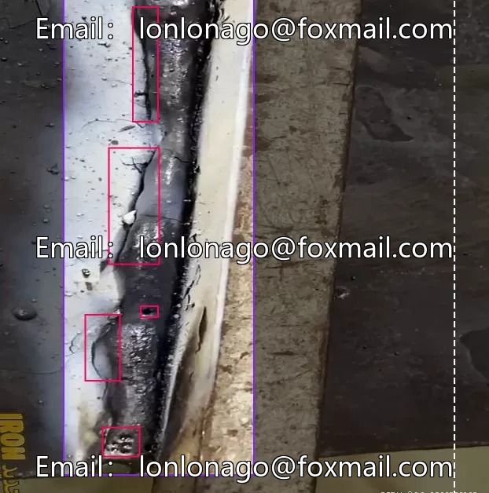
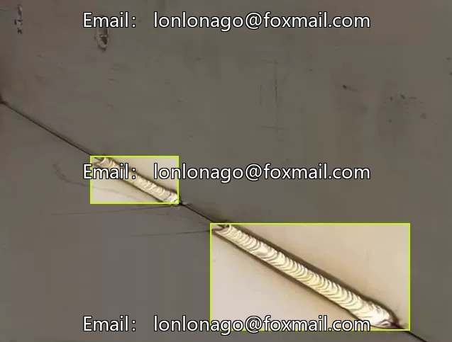
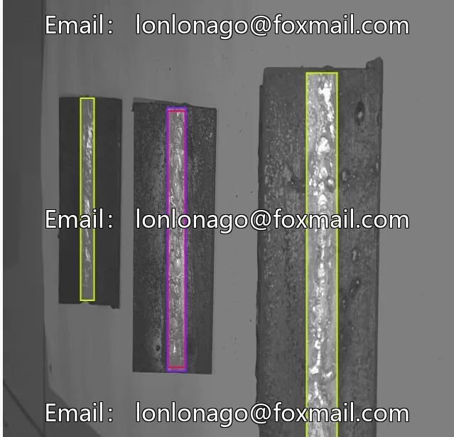
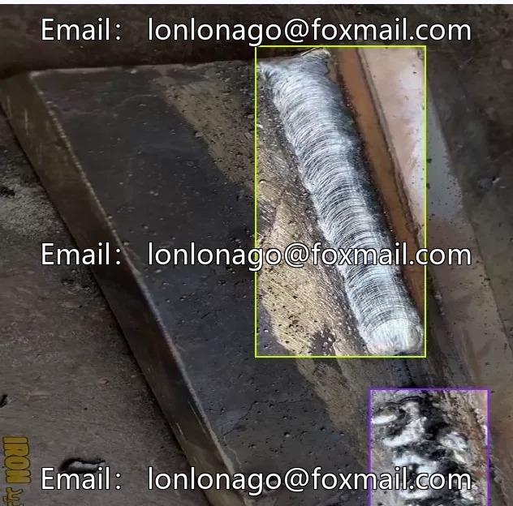
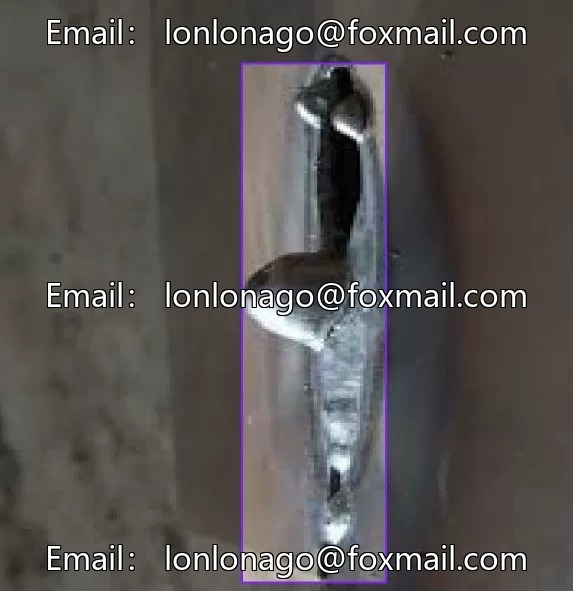
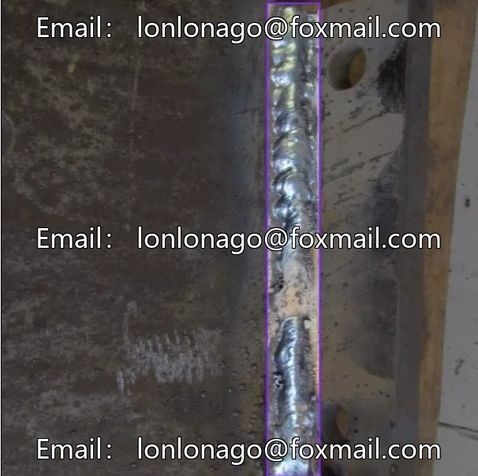

# Welding Defect Image Dataset

## Body

Welding Defect Image Dataset - Weld Seam Defect Dataset, consisting of 2000 images, including three annotation categories: welding defects, defects, and good welding.
Each image is precisely labeled, suitable for AI model training and weld quality inspection.
The dataset can be used in manufacturing enterprises for automated inspection, reducing human subjective judgment errors.
Supports real-time quality inspection on production lines, intercepting defective products in advance.
Data format is image files, each picture carries annotation information.
Virtual material, once sold, will not be refunded.
Interested friends, click "I want" to proceed.

## Images

## Payment

Here is a pay link on Stripe ( https://buy.stripe.com/3cs8yP7sY87d0vu9AB ). Please contact me lonlonago@foxmail.com after funding $89, and I will send you a complete data files , thank you!

